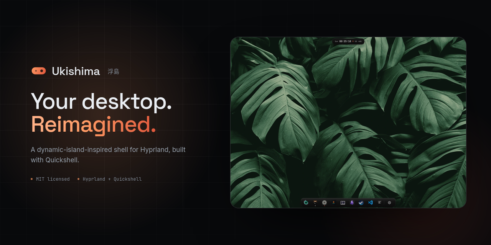

# 浮島 Ukishima

> A dynamic-island Quickshell shell for Hyprland and niri.

Ukishima (浮島, *"floating island"*) is a widget layer for Hyprland and niri built around a morphing pill at the top of every monitor that expands in place into a control centre, plus a floating macOS-style 泊 dock at the bottom edge for pinned and running apps. Fully self-contained — it makes no changes to your compositor configuration.

## Preview

<p align="center">
<a href="https://ukishima.uklab.workers.dev/">
  
</a>
</p>

Explore the animated showcase, features and settings on the [Ukishima website](https://ukishima.uklab.workers.dev/).

## Features

- **Dynamic island** — one morphing pill per monitor. Modules grow their surfaces out of it in place; right-click walks the pill through media, timer, and up to two more surfaces you pick under **Settings → Interface → Right-click**.
- **泊 Dock** — pinned and running apps with hover magnification and multi-window previews, auto-hide, and its own theme and glass.
- **Surfaces** — launcher, emoji, weather, calendar, media, mixer, wallpaper strip + Wallhaven search, screen recorder, clipboard, Wi-Fi, Bluetooth, battery, power menu, system monitor, notifications, OSD, toasts, scratchpad, settings.
- **Wallpapers** — shuffled `awww` bag, live `mpvpaper` videos, per-wallpaper fit, and a palette that retints the UI.
- **Compositor-aware** — workspaces, window state, keyboard layout, lock backends, and dependency checks all follow the active compositor. Hyprland-only features are hidden on niri.
- **Extras** — night light (Hyprland), game mode, keep-awake, in-app updater.

## Requirements

- Linux + Wayland, **Hyprland** or **niri**
- **Quickshell** 0.3.0+
- CLI tools checked by the installer — see [Dependencies](docs/DEPENDENCIES.md)

## Install

```bash
curl -fsSL https://raw.githubusercontent.com/amanhex/Ukishima/master/remote-install.sh | bash
```

Clones to `~/.local/share/quickshell/ukishima`, checks the tools your compositor needs, and prints the matching startup command. An existing clean, official `master` checkout with no local commits is updated only after confirmation; local changes and other directories are left untouched. The installer does not edit your configuration.

## Launch

**Hyprland** (`~/.config/hypr/hyprland.conf`):

```ini
exec-once = ~/.local/share/quickshell/ukishima/launch.sh
```

**Hyprland — Lua**:

```lua
hl.exec_cmd("~/.local/share/quickshell/ukishima/launch.sh")
```

**niri** (`~/.config/niri/config.kdl`):

```kdl
spawn-at-startup "sh" "-c" "exec $HOME/.local/share/quickshell/ukishima/launch.sh"
```

Start `awww-daemon` alongside the shell so wallpapers apply immediately:

```ini
# Hyprland
exec-once = awww-daemon
```

```kdl
# niri
spawn-at-startup "awww-daemon"
```

## Keybinds

Ukishima does not modify your keybindings. For example:

```bash
qs -p ~/.local/share/quickshell/ukishima ipc call ukishima launcher ""
```

See the [Keybindings & IPC Guide](docs/KEYBINDINGS.md) for Hyprland, Hyprland Lua, and niri examples and the full IPC list.

## Lock

Ukishima provides its own lockscreen and supports external lockers:

- **Hyprland** — Hyprlock or Quickshell
- **niri** — swaylock or Quickshell

Choose a backend under **Settings → Lock**, then bind `~/.local/share/quickshell/ukishima/scripts/lock.sh` to a shortcut.

## Update

Open **Settings → Update**, click **Check for Updates**, and select **Update Ukishima**. The in-app updater keeps local modifications.

To update from a terminal, run the install command again. It asks before updating and only touches a clean, official `master` checkout tracking `origin/master` with no local commits. Local changes and development checkouts are left alone.

## Troubleshooting

Quickshell output is written to `$XDG_STATE_HOME/ukishima/ukishima.log` (default `~/.local/state/ukishima/ukishima.log`), with one rotated copy, and is also printed to the terminal when you launch from one. Check the log for private paths before attaching it to an issue. To see which tools are missing, run:

```bash
~/.local/share/quickshell/ukishima/scripts/check-deps.sh
```

## Uninstall

```bash
curl -fsSL https://raw.githubusercontent.com/amanhex/Ukishima/master/uninstall.sh | bash
```

This completely removes Ukishima: application files, settings, state, caches, and generated wallpaper stills. It does not touch personal wallpapers, other applications, or compositor configuration. Remove any Ukishima startup commands or keybindings afterwards.

## Credits

Built on top of [**Ricelin**](https://github.com/Gakuseei/Ricelin) by [**Gakuseei**](https://github.com/Gakuseei) — the pill concept, the morphing-surface architecture and most of the original codebase. All credit for the base code goes to the original author.
