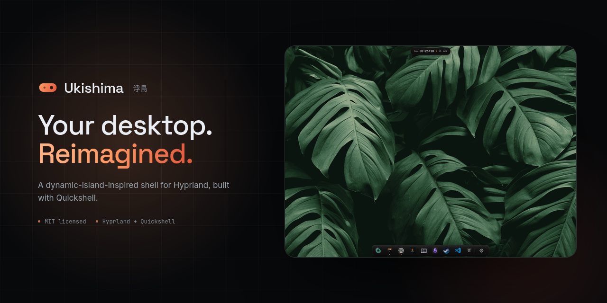

# 浮島 Ukishima

> A Quickshell desktop shell for Hyprland and niri.

Ukishima (浮島, *"floating island"*) puts a pill at the top of every monitor and a dock along the bottom. The pill expands in place into surfaces — launcher, media, settings and the rest — rather than opening separate panels. It is a self-contained Quickshell config and does not edit your compositor files.

## Preview

<p align="center">
<a href="https://ukishima.uklab.workers.dev/">
  
</a>
</p>

Explore the animated showcase, features and settings on the [Ukishima website](https://ukishima.uklab.workers.dev/).

## Features

- **Pill** — one per monitor. Hovering expands it into a row of modules; surfaces open from the pill and fold back into it when dismissed. Right-clicking the pill cycles through the media surface, the timer, and up to two more surfaces chosen under **Settings → Interface → Right-click**.
- **Dock** — pinned and running apps, hover magnification, window previews, auto-hide, and its own theme.
- **Surfaces** — launcher, emoji, weather, calendar, media player, mixer, wallpaper browser and Wallhaven search, screen recorder, clipboard, Wi-Fi, Bluetooth, battery, power menu, system monitor, scratchpad and settings.
- **Surface styles** — the pill, media player, mixer, system monitor, scratchpad and lock screen each offer several layouts, under **Settings → Appearance → Surface Styles**.
- **Wallpapers** — shuffled image wallpapers through `awww`, video wallpapers through `mpvpaper`, a cover/contain/stretch/center fit, and a palette taken from the current wallpaper.
- **Compositor-aware** — workspaces, window state, keyboard layout, lock backends and dependency checks follow Hyprland or niri. Hyprland-only features are hidden on niri.
- **Extras** — night light (Hyprland), game mode, keep-awake and an in-app updater.

## Requirements

- Linux with Wayland, running **Hyprland** or **niri**
- **Quickshell** 0.3.0 or newer
- The command-line tools listed in [Dependencies](docs/DEPENDENCIES.md)

## Install

```bash
curl -fsSL https://raw.githubusercontent.com/amanhex/Ukishima/master/remote-install.sh | bash
```

The installer clones into `~/.local/share/quickshell/ukishima`, checks the tools your compositor needs, and prints the startup line for your compositor config. If that directory already contains a clean official `master` checkout, it offers to update it; anything else is left untouched.

## Launch

**Hyprland** (`~/.config/hypr/hyprland.conf`):

```ini
exec-once = ~/.local/share/quickshell/ukishima/launch.sh
```

**Hyprland — Lua**:

```lua
hl.exec_cmd("~/.local/share/quickshell/ukishima/launch.sh")
```

**niri** (`~/.config/niri/config.kdl`):

```kdl
spawn-at-startup "sh" "-c" "exec $HOME/.local/share/quickshell/ukishima/launch.sh"
```

Start `awww-daemon` alongside the shell so wallpapers apply immediately:

```ini
# Hyprland
exec-once = awww-daemon
```

```kdl
# niri
spawn-at-startup "awww-daemon"
```

## Keybinds

Ukishima does not install keybindings. Call its IPC from your own, for example:

```bash
qs -p ~/.local/share/quickshell/ukishima ipc call ukishima launcher ""
```

See the [Keybindings & IPC Guide](docs/KEYBINDINGS.md) for Hyprland, Hyprland Lua and niri examples, plus the full IPC list.

## Lock

Ukishima provides its own lockscreen and can also hand off to an external locker:

- **Hyprland** — Hyprlock or Quickshell
- **niri** — swaylock or Quickshell

Choose a backend under **Settings → Lock screen**, then bind `~/.local/share/quickshell/ukishima/scripts/lock.sh` to a shortcut.

## Update

Open **Settings → Update** and choose **Check for Updates**. The updater only works on a clean official `master` checkout: uncommitted changes block it, and any other checkout is refused. When updates are available it fast-forwards and reloads the shell.

You can also run the install command again. It asks before updating and, like the in-app updater, only touches a clean `master` checkout that tracks `origin/master`; local changes and development checkouts are left alone.

## Troubleshooting

Quickshell output is written to `$XDG_STATE_HOME/ukishima/ukishima.log` (default `~/.local/state/ukishima/ukishima.log`), with one rotated copy, and is also printed to the terminal when you launch from one. The log can contain file paths, so check it before posting it publicly. To see which tools are missing, run:

```bash
~/.local/share/quickshell/ukishima/scripts/check-deps.sh
```

## Uninstall

```bash
curl -fsSL https://raw.githubusercontent.com/amanhex/Ukishima/master/uninstall.sh | bash
```

The script asks for confirmation, stops a running shell, and removes the application directory, settings, state, caches and generated wallpaper stills. It refuses to remove a modified or non-`master` git checkout. Your own wallpapers, other applications and compositor configuration are not touched. Remove the startup line and any keybindings afterwards.

## Credits

Built on top of [**Ricelin**](https://github.com/Gakuseei/Ricelin) by [**Gakuseei**](https://github.com/Gakuseei) — the pill concept, the morphing-surface architecture and most of the original codebase. All credit for the base code goes to the original author.

The media, mixer, system monitor, scratchpad and lock screen surface styles are inspired by [**Chaldea**](https://github.com/Aleph1-9012/Chaldea) by [**Aleph1-9012**](https://github.com/Aleph1-9012).
